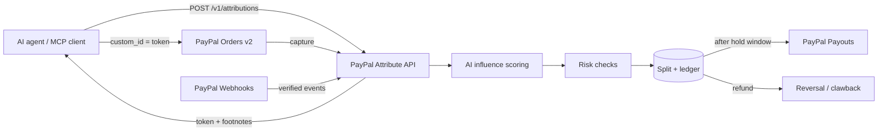

# PayPal Attribute

**Every AI answer has sources. Now every source gets paid.**

PayPal Attribute is an attribution and payout rail for agentic commerce, built on the PayPal developer platform. When an AI shopping agent recommends a product, it cites the creators whose reviews, guides and videos shaped the answer. The citations ride inside the PayPal order. When the payment is captured, AI scores how much each source influenced the purchase, risk checks remove fraud, and the merchant's commission is split and paid to creators through **PayPal Payouts**, with refunds unwinding automatically.

> Hackathon prototype proposed for the PayPal developer platform. Not an official PayPal product. Runs entirely in the PayPal **sandbox**; no real money moves. All merchants, products and creators in the demo are fictional.

---

## The problem

AI agents are becoming the storefront. Shoppers ask "what should I buy?" and get a single answer: no clicks, no affiliate links.

- **Creators** whose reviews make AI answers trustworthy lose the affiliate income that funds their work.
- **Merchants** can't see which conversation or which content drove a sale, or reward it.
- **Agent developers** have no standard way to make recommendations monetisable without sacrificing trust.

PayPal already sits at checkout, already pays people in 200+ markets, and already has the accounts of merchants and creators. PayPal Attribute is the missing layer that connects them.

## What it does

| Page | What you can do |
|---|---|
| **Shop with AI** (`/shop`) | Chat with a shopping agent. Every claim carries a footnote to a real creator source. Buy with PayPal. |
| **Sale attribution** (`/attribution/:id`) | Watch one sale go end to end: question → citations → PayPal order with `custom_id` → capture → AI influence scores → 6 risk checks → commission split → hold window → PayPal Payouts batch → refund/clawback. Every cent explained, with a full ledger. |
| **Merchants** (`/merchants`) | AG Grid ledger of AI-attributed orders (search, filter, sort, CSV export), AG Charts revenue and creator influence, ask-your-data AI insights, and attribution rules (commission %, monthly cap, hold window, min/max share). |
| **Creators** (`/creators`) | Connect PayPal (Log in with PayPal), see citations, earnings, payout schedule and clawbacks, and register new content, which is screened before it can earn. |
| **Developers** (`/developers`) | REST API with live playground, sandbox API keys, OpenAPI 3.1 spec, Postman collection, and an MCP server so any agent can integrate without custom code. |
| **Risk** (`/risk`) | Review queue for velocity spikes, budget caps, self-dealing, citation stuffing and prompt-injected content. Approving or confirming fraud releases or cancels payouts. |

## How PayPal is used

| PayPal capability | Where | What it does in PayPal Attribute |
|---|---|---|
| **JavaScript SDK (Smart Payment Buttons)** | `src/components/paypal-buttons.tsx` | Shopper checks out with PayPal inside the AI shopping agent. |
| **Orders v2**: create & capture | `src/lib/paypal.ts`, `src/app/api/checkout/*` | The attribution token travels in `purchase_units[].custom_id`; on capture we verify it round-tripped before any money is allocated. Idempotent with `PayPal-Request-Id`. |
| **Payouts v1** | `releaseDuePayouts()` in `src/lib/engine.ts` | After the return window, every creator who influenced a sale is paid in one batch. |
| **Payments v2**: refund capture | `src/app/api/sales/[id]/refund` | Refunds reverse held payouts, or create clawbacks netted against future earnings. |
| **Webhooks**: signature verification | `src/app/api/paypal/webhook` | `PAYMENT.CAPTURE.COMPLETED`, `PAYMENT.CAPTURE.REFUNDED` and `PAYMENT.PAYOUTS-ITEM.*` are verified with `verify-webhook-signature` and processed idempotently by event ID. |
| **Log in with PayPal** (OpenID Connect) | `src/app/api/creators/[id]/connect`, `src/app/api/auth/paypal/callback` | Creators connect the PayPal account that receives their payouts. |

## How AI is used

AI decides *who earned the money and why*. It's in the money path, not decoration.

1. **Shopping agent**: retrieval runs in code (partner catalog, Channel3, registered creator content); the model writes a grounded, footnoted answer as structured JSON, and every citation is validated against real, unblocked sources before it is shown. (`src/lib/agent.ts`)
2. **Influence scoring**: on capture, the model scores how much each cited source influenced the purchase of *that* product, with a plain-English reason per creator. Scores are blended 75/25 with a deterministic baseline so one model response can't swing money wildly. (`scoreInfluenceAI` in `src/lib/ai.ts`)
3. **Content screening**: new creator content is screened for prompt injection, keyword stuffing, low information and undisclosed sponsorship before it can earn. (`screenContentAI`)
4. **Merchant insights**: merchants ask questions about their attributed sales in plain English. (`merchantInsightAI`)

**Models: a fallback chain using free-tier providers.**

```
1. Groq              GROQ_API_KEY    default model llama-3.3-70b-versatile (free tier)
2. Google Gemini     GEMINI_API_KEY  default model gemini-flash-latest (free tier)
3. Built-in rules    always on       deterministic scoring, screening and agent
```

Each AI call tries Groq first. If Groq is not configured, errors, times out or returns output that fails schema validation (zod), the same call goes to Gemini, and then to the built-in rules. Both providers are called through their OpenAI-compatible Chat Completions endpoints with JSON output, so one small client (`src/lib/ai.ts`) covers both. The UI and API always show which engine answered (for example "AI agent (Gemini)" or "Built-in rules agent"), and every split records the provider that scored it.

**Works with no keys at all.** The built-in rules (`src/lib/scoring.ts`, `runRulesAgent`) run the whole product end to end for judges with zero configuration.

## The money math

For an order of amount $A$, merchant commission rate $r$ and network fee $f$ (10% of commission):

```
commission = round(r × A)
fee        = round(f × commission)
pool       = commission − fee
share_i    = clamp(influence_i / Σ influence, minShare, maxShare)   (renormalised)
payout_i   = pool × share_i      (largest-remainder rounding: Σ payout_i == pool, exactly)
```

- Sources below the merchant's minimum share are dropped (trivial mentions earn nothing).
- No creator can exceed the maximum share when others contributed.
- Each creator gets one share: their strongest source counts fully, extra sources add 15% (anti-stuffing).
- All money is stored in integer cents; every movement writes an append-only ledger entry.

## Risk checks (every captured sale)

| Check | Effect |
|---|---|
| Self-dealing | Buyer's PayPal email matches a cited creator → that creator's share is removed |
| Clean sources | Blocked (prompt-injected) sources earn nothing |
| Citation stuffing | Repeated citations from one creator collapse into one share |
| Merchant budget | Over the monthly cap → payouts held for merchant review |
| Purchase velocity | ≥4 attributed purchases by one buyer in 24 h → held for review |
| Attribution window | Token older than 7 days at purchase → blocked |

## Architecture



- **Next.js 15 (App Router) + TypeScript**: one service serves the UI and the API.
- **Storage**: a small persistent document store (`src/lib/store.ts`) with serialised, atomic writes. Every access goes through one module, so it can be swapped for Postgres without touching callers.
- **Seeded history**: 30 days of traffic is generated by running the *real engine* over simulated orders (`src/lib/seed.ts`), so every number on every dashboard comes from the same code paths a live sale uses.

## Sponsor tools

| Tool | How it's used |
|---|---|
| **AG Grid** + **AG Charts** | Merchant and creator ledgers (sorting, filtering, quick search, pagination, CSV export, custom status renderers, row-click to trace) and revenue/earnings/influence charts, themed to the design system. |
| **Render** | `render.yaml` Blueprint: one-click deploy of the web service with health check and env vars. |
| **APIMatic** | `GET /api/v1/openapi.json` is an OpenAPI 3.1 spec ready to import into APIMatic for SDK generation and a docs portal. |
| **Channel3** | Optional live product catalog: set `CHANNEL3_API_KEY` and the shopping agent searches Channel3's `/v1/search` alongside the partner catalog. |
| **Postman** | `GET /api/v1/postman.json` is a generated Postman v2.1 collection with auth and example bodies. |

---

## Run it locally (no Docker)

Requirements: **Node.js 20.9+** (22 recommended).

```bash
git clone <your-repo-url> paypal-attribute
cd paypal-attribute
npm install
cp .env.example .env.local   # optional: the demo works with no keys
npm run dev
```

Open http://localhost:3000. With no keys, checkout and AI run in clearly-labelled demo mode; everything else (attribution, scoring, risk, splits, ledger, holds, refunds, clawbacks) is the real engine.

Styling: Tailwind CSS is precompiled into `src/app/styles.css`, so nothing CSS-related is compiled on your machine. After changing classes or `globals.css`, run `npm run css`.

Production build:

```bash
npm run build && npm start
```

Tests (split math, ledger integrity, self-dealing, refunds, screening):

```bash
npm test
```

### Use the real PayPal sandbox

1. Go to [developer.paypal.com](https://developer.paypal.com) → **Apps & Credentials** → **Sandbox** → create an app.
2. Copy the **Client ID** and **Secret** into `.env.local` as `PAYPAL_CLIENT_ID` and `PAYPAL_CLIENT_SECRET`.
3. *(Optional)* In the app settings under **Other features**, enable **Log in with PayPal** → **Advanced Settings**, add `http://localhost:3000/api/auth/paypal/callback` as the return URL (share email), then set `PAYPAL_LOGIN_ENABLED=true`. Without it, the Creators page uses a labelled demo connection.
4. Check out with a **sandbox personal account** from Sandbox → Accounts.
5. *(Webhooks, on a public URL)*: add a webhook pointing to `https://<host>/api/paypal/webhook` for `PAYMENT.CAPTURE.COMPLETED`, `PAYMENT.CAPTURE.REFUNDED` and `PAYMENT.PAYOUTS-ITEM.*`, then set `PAYPAL_WEBHOOK_ID`. Checkout works without webhooks: capture is handled synchronously and the webhook path is idempotent.

### Enable AI (free)

- **Gemini (free tier):** create a key at [aistudio.google.com/apikey](https://aistudio.google.com/apikey) and set `GEMINI_API_KEY`.
- **Groq (free tier, first in the chain):** create a key at [console.groq.com/keys](https://console.groq.com/keys) and set `GROQ_API_KEY`.

The Shop page badge shows the active chain, e.g. "AI: Groq → Gemini → rules". Model IDs change over time; override them with `GROQ_MODEL` / `GEMINI_MODEL` if a default is retired.

### Environment variables

| Variable | Required | Purpose |
|---|---|---|
| `PAYPAL_CLIENT_ID` / `PAYPAL_CLIENT_SECRET` | for real checkout | PayPal sandbox REST credentials |
| `PAYPAL_WEBHOOK_ID` | for webhooks | Webhook signature verification |
| `PAYPAL_ENV` | no | `sandbox` (default) |
| `PAYPAL_LOGIN_ENABLED` | no | `true` to use real Log in with PayPal on the Creators page |
| `GROQ_API_KEY` | optional | Groq (free tier), first AI in the chain |
| `GROQ_MODEL` | no | Defaults to `llama-3.3-70b-versatile` |
| `GEMINI_API_KEY` | optional | Google Gemini (free tier), second AI in the chain |
| `GEMINI_MODEL` | no | Defaults to `gemini-flash-latest` |
| `CHANNEL3_API_KEY` | no | Live product catalog |
| `APP_URL` | on hosting | Public URL (Log in with PayPal return URL, API docs) |
| `DATA_DIR` | no | Where `db.json` is stored (default `./data`) |

## Deploy on Render

1. Push this repo to GitHub.
2. In Render: **New → Blueprint** → select the repo. `render.yaml` configures the service.
3. Fill in the secret env vars (PayPal keys, `GROQ_API_KEY` and/or `GEMINI_API_KEY`, `APP_URL=https://<your-service>.onrender.com`).
4. Add `https://<your-service>.onrender.com/api/auth/paypal/callback` as the Log in with PayPal return URL and point the PayPal webhook at `/api/paypal/webhook`.

The Blueprint uses the `starter` plan so the demo doesn't sleep during judging. Demo state resets on redeploy; use **Reset demo** in the header at any time.

## Public API

Base URL `/api/v1`, auth `Authorization: Bearer pa_test_…` (a demo key is shown on `/developers`).

| Method | Path | Purpose |
|---|---|---|
| `POST` | `/attributions` | Register the sources behind a recommendation → token + footnotes |
| `GET` | `/attributions` | Recent attributions for this key |
| `GET` | `/attributions/{token}` | Attribution with resulting sales, split and payouts |
| `GET` | `/sources?q=` | Search citable creator content |
| `POST` | `/sources` | Register creator content (screened) |
| `GET` | `/sales/{id}` | Sale with AI-scored split and payouts |
| `GET` | `/creators/{id}/earnings` | Creator earnings summary |

Full spec: `/api/v1/openapi.json`. Postman: `/api/v1/postman.json`.

## MCP server

```bash
ATTRIBUTE_API_URL=http://localhost:3000/api/v1 ATTRIBUTE_API_KEY=pa_test_demo_7kq2vx9mn4pr8st1wz npm run mcp
```

Tools: `search_sources`, `attribute_recommendation`, `get_attribution`, `get_creator_earnings`. Add it to any MCP-capable agent with the config shown on `/developers`.

## Project structure

```
src/
  app/                 pages + API routes (Next.js App Router)
    api/v1/            public API (attributions, sources, sales, creators, openapi, postman)
    api/checkout/      PayPal order create / capture (+ simulated checkout)
    api/paypal/webhook PayPal webhooks (verified, idempotent)
  components/          design system, PayPal buttons, AG Grid/Charts wrappers
  lib/
    engine.ts          attribution → split → payouts → refunds (the core)
    split.ts           pure commission math (unit-tested)
    scoring.ts         deterministic influence scoring + content screening
    risk.ts            fraud & abuse checks
    ai.ts              AI fallback chain (Groq → Gemini) + scoring, screening, insights
    agent.ts           shopping agent (AI tool loop + rules fallback)
    paypal.ts          PayPal REST client (Orders, Payments, Payouts, Webhooks, Identity)
    channel3.ts        Channel3 catalog client
    seed.ts            30-day history generated by the real engine
mcp/server.mjs         MCP server
tests/                 Vitest unit tests
render.yaml            Render Blueprint
```

## Limitations and what's next

- Demo hold windows are minutes; production would use each merchant's return policy in days.
- Storage is a single-process document store; production would use Postgres with row-level locking on the ledger.
- Next: native attribution metadata on PayPal orders and payout splitting, multi-currency payouts, publisher-level licensing, and a path for affiliate networks into the agentic era.

## License

[MIT](./LICENSE)
